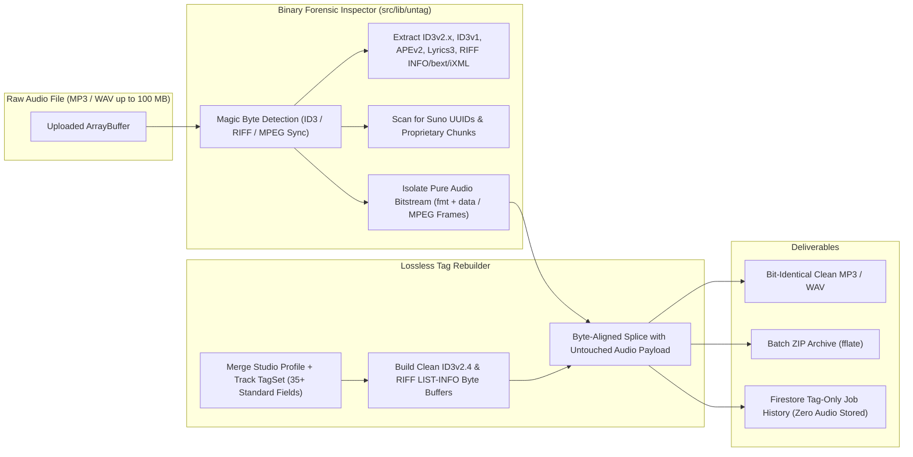

# untag — Lossless Binary Audio Metadata Inspector, AI Watermark Sanitizer & Tag Rebuilder

[](https://www.typescriptlang.org/)
[](https://react.dev/)
[](https://pages.cloudflare.com/)
[](https://developer.mozilla.org/en-US/docs/Web/API/Web_Workers_API)
[](https://vitest.dev/)

> **Executive Summary (EN):** **untag** is a zero-re-encoding binary audio metadata inspector and tag rebuilder for **MP3** and **WAV** masters. Written from scratch in pure TypeScript without external FFmpeg or native binary dependencies, it parses and strips `ID3v2.2/2.3/2.4`, `ID3v1`, `APEv2`, `Lyrics3`, and `RIFF/WAV` chunks (`LIST-INFO`, `id3 `, `bext`, `iXML`, plus unknown proprietary chunks and AI-generation markers like Suno UUIDs), then reconstructs clean `ID3v2.4` and `RIFF LIST-INFO` headers while leaving the underlying audio bitstream **100% bit-identical**.
>
> **Executive Summary (NL):** **untag** is een lossless binaire audio-metadata inspecteur en cleaner voor **MP3**- en **WAV**-bestanden. Zonder de audiostroom opnieuw te encoderen (0% kwaliteitsverlies) ontleedt en verwijdert de engine alle bestaande metadata-containers, verborgen chunks en AI-generatie-watermerken (zoals Suno-fingerprints), en schrijft een schone, gestandaardiseerde tag-structuur weg — zowel **client-side via Web Workers** als **edge-side via Cloudflare Pages Functions**.

---

## Why This Project Stands Out Technically (For Technical Recruiters & CTOs)

Most audio web tools rely on server-side FFmpeg wrappers or heavy WebAssembly blobs that decode and re-encode audio streams. **untag** is a showcase of **low-level binary protocol engineering in TypeScript**:

1. **Custom Zero-Dependency Binary Parser & Serializer (`src/lib/untag/index.ts` — 750+ LOC)**:
   - **MP3 Container Surgery**: Parses synchsafe integers, extended headers, unsynchronisation flags, UTF-8 / UTF-16LE / UTF-16BE / Windows-1252 text encodings, attached cover art (`APIC`/`PIC`), `ID3v1` trailers, `APEv2` footers, and `Lyrics3` blocks. Isolates the exact byte range of the MPEG audio frames (evaluating Xing/Info/VBRI VBR headers for accurate bitrate and duration calculation) and prepends a freshly serialized `ID3v2.4` header.
   - **RIFF/WAV Chunk Surgery**: Walks the 32-bit little-endian RIFF chunk tree (`fmt `, `data`, `LIST`, `id3 `, `bext`, `iXML`), strips non-audio metadata and proprietary broadcast/AI chunks while preserving word-aligned (`2-byte` padded) PCM/IEEE-float `fmt ` and `data` chunks, and writes clean `LIST-INFO` + embedded `ID3v2.4` chunks.
2. **AI Provenance & Suno Fingerprint Detection**:
   - Automatically scans comments, `TXXX` frames, software tags, and raw container bytes for embedded AI generator signatures (e.g., Suno UUID patterns and creation timestamps) and surfaces them in the forensic inspection view before stripping.
3. **Dual-Execution Architecture (Edge API + Transferable Web Worker Fallback)**:
   - **Cloudflare Pages Functions (`/api/inspect`, `/api/clean`)**: Processes up to 100 MB audio files synchronously in edge memory, returning clean binaries + base64url-encoded inspection diagnostics in custom response headers (`X-Untag-Inspection`).
   - **Zero-Copy Browser Web Worker (`audio.worker.ts`)**: Uses `postMessage(request, [request.bytes])` with transferable `ArrayBuffer` ownership for instant, main-thread-free local processing when offline or working with private studio masters.
4. **Multi-File Batch Processing & Instant ZIP Mastering**:
   - Drag-and-drop batch queue with per-track metadata overrides, reusable studio preset profiles (persisted locally and synced via **Firebase Auth + Cloud Firestore**), cover-art embedding, and one-click batch ZIP archiving powered by `fflate`.
   - Full **5-language internationalization (EN, NL, DE, FR, ES)** in `src/translations.ts`.

---

## Architecture & Binary Processing Pipeline



---

## Supported Metadata Containers & Tag Standards

### Inspected & Stripped Containers
- **MP3**: `ID3v2.2`, `ID3v2.3`, `ID3v2.4` (including `PRIV`, `GEOB`, `UFID`, `POPM`, `PCNT`, `TXXX`, `WXXX`, `APIC`), `ID3v1` / `ID3v1.1`, `APEv2`, `Lyrics3v2`.
- **WAV (RIFF)**: `RIFF LIST-INFO` (`INAM`, `IART`, `IPRD`, `ICRD`, `IGNR`, `ICOP`, `ICMT`, `ISFT`, `IENG`, `ITRK`), `RIFF id3 `, Broadcast Wave `bext`, `iXML`, and unknown non-audio chunks.

### 35+ Rebuilt Standard Fields (`TagSet`)
- **Titles & Performers**: Grouping (`TIT1`), Title (`TIT2`), Subtitle (`TIT3`), Artist (`TPE1`), Album Artist (`TPE2`), Conductor (`TPE3`), Remixer (`TPE4`).
- **Authors & Album**: Composer (`TCOM`), Lyricist (`TEXT`), Original Artist (`TOPE`), Album (`TALB`), Track (`TRCK`), Disc (`TPOS`), Compilation (`TCMP`).
- **Dates & Musical Properties**: Recording Date (`TDRC`), Original Date (`TDOR`), Release Date (`TDRL`), Genre (`TCON`), BPM (`TBPM`), Initial Key (`TKEY`), Mood (`TMOO`).
- **Sorting, Rights & Artwork**: Title/Artist/Album/Composer Sort (`TSOT`, `TSOP`, `TSOA`, `TSOC`), Language (`TLAN`), Media Type (`TMED`), ISRC (`TSRC`), Publisher (`TPUB`), Copyright (`TCOP`), Producer Rights (`TPRO`), Encoded By (`TENC`), Comment (`COMM`), Unsynced Lyrics (`USLT`), Official Website (`WOAR`), and Cover Art (`APIC`).

---

## Tech Stack

| Layer | Technology |
| :--- | :--- |
| **Core Binary Engine** | Pure TypeScript (`DataView`, `Uint8Array`, `TextDecoder`, `TextEncoder`) — zero audio libraries |
| **Frontend UI** | React 18.3, Vite 6, Tailwind CSS 3.4, Lucide Icons, `fflate` (fast ZIP compression), PWA Web Manifest |
| **Concurrency** | Native ES Module Web Workers with transferable `ArrayBuffer`s |
| **Edge Runtime** | Cloudflare Pages Functions (`functions/api/inspect.ts`, `functions/api/clean.ts`), Wrangler |
| **Cloud & Auth** | Firebase Authentication (Google OAuth + Email/Password) & Cloud Firestore (Studio Profiles & Tag History) |
| **Testing** | Vitest (`tests/untag.test.ts` — binary round-trip verification for MP3 & WAV) |

---

## Local Development & Verification

### Prerequisites
- **Node.js** v20+ and `npm`

### 1. Run Frontend & Web Worker Locally
```bash
git clone https://github.com/JamalDrenthe/untag.git
cd untag
npm install
npm run dev
```

### 2. Run Unit & Binary Integrity Tests
```bash
npm test
```

### 3. Emulate Cloudflare Pages Edge Functions Locally
```bash
npm run build
npx wrangler pages dev dist --port 8788
```

### 4. Optional Firebase Configuration (`.env.local`)
Firebase is strictly optional—audio files never leave the user's device or temporary edge memory. To enable cloud-synced Studio Profiles and tag-only job history, configure:
```env
VITE_FIREBASE_API_KEY=...
VITE_FIREBASE_AUTH_DOMAIN=...
VITE_FIREBASE_PROJECT_ID=...
VITE_FIREBASE_APP_ID=...
```

---

## About the Author & Collaboration

Engineered by **Jamal Drenthe** — Full-Stack Software Engineer, Binary/Audio Systems Architect & Founder of **Quantum Initium**.

Looking for a **Senior/Staff Engineer** or **technical partner** who can build everything from low-level binary parsers and edge workers to polished, multi-language SaaS products?

- **GitHub**: [@JamalDrenthe](https://github.com/JamalDrenthe)
- **Email**: [info@jamaldrenthe.com](mailto:info@jamaldrenthe.com)
